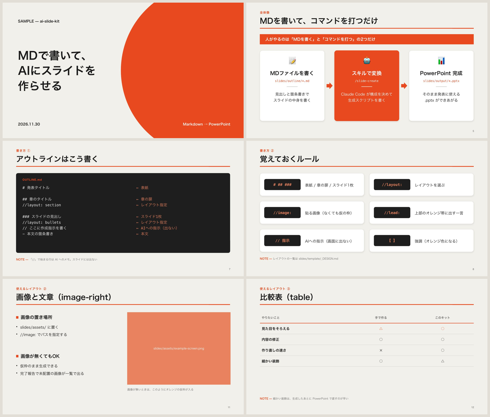

# ai-slide-kit

**Markdown でスライドの中身を書くと、Claude Code が PowerPoint（.pptx）にしてくれる**キットです。
勉強会・社内共有の資料づくりを「書く」から「AIに書き出させる」に変えるためのものです。

```
slides/outline/my-talk.md  ──  /slide-create  ──▶  slides/output/my-talk.pptx
     （中身を書く）            （Claude Code）           （そのまま発表に使える）
```



見本（`npm run example` で作れる）。オレンジ × ベージュの勉強会向けデザインで、表紙・章扉・カード・フロー図・コード・比較表など 20 種類以上のレイアウト入りです。

---

## 必要なもの

| もの | 用途 | 入手先 |
|---|---|---|
| **Claude Code** | スライドを作らせる本体 | https://code.claude.com/docs （Pro / Max などの有料プランが必要） |
| **Node.js 18 以上** | .pptx を書き出す（pptxgenjs） | https://nodejs.org |
| Git | clone 用 | |
| LibreOffice（任意） | 生成物を PDF / 画像にして見た目を自動チェックする | https://www.libreoffice.org |

---

## はじめかた（5分）

### 1. clone してインストール

```bash
git clone <このリポジトリのURL> ai-slide-kit
```

```bash
cd ai-slide-kit
```

```bash
npm install
```

### 2. 見本を作ってみる（任意）

```bash
npm run example
```

`slides/output/example.pptx` ができれば準備OKです。

### 3. Claude Code を開く

```bash
claude
```

初回はこのフォルダを「信頼する」か聞かれるので許可します。
続けて **`document-skills` プラグインを入れるか** 聞かれたら「インストール」を選んでください（`.claude/settings.json` で推奨設定済み）。
聞かれなかった場合は、Claude Code の中で次を実行します。

```
/plugin marketplace add anthropics/skills
/plugin install document-skills@anthropic-agent-skills
```

---

## 使い方

### いちばん簡単なやり方：話すだけ

Claude Code にこう頼むだけで、アウトライン作成 → スライド生成まで進みます。

```
来週の勉強会で「Gitの基本」を20分話したい。初心者向け。
ブランチ、コミット、プルリクの順で。アウトラインを作って、/slide-create までやって
```

最初に **目的・聞き手・時間** を伝えると、構成がブレにくくなります。

### ちゃんと作るやり方：MD を書いてから生成

1. 雛形をコピーする

   ```bash
   cp slides/template/_TEMPLATE.md slides/outline/my-talk.md
   ```

2. `slides/outline/my-talk.md` の `【】` を埋める（いらないスライドは消す）
3. Claude Code で生成する

   ```
   /slide-create slides/outline/my-talk.md
   ```

4. `slides/output/my-talk.pptx` を開いて確認。直したいところは **MD を直してもう一度** `/slide-create` するか、
   「3枚目の文字を大きくして」のように Claude Code に頼む

### アウトラインの書き方

```markdown
# 発表タイトル                ← 表紙

## 章のタイトル               ← 章の扉スライド
//layout: section

### スライドの見出し           ← スライド1枚
//layout: bullets             ← レイアウトを選ぶ
// 初心者向けに、たとえ話で    ← AIへの指示（スライドには出ない）
- 本文の箇条書き
- 【強調したい語】            ← オレンジ色になる
```

| 書き方 | 意味 |
|---|---|
| `#` / `##` / `###` | 表紙 / 章の扉 / スライド1枚 |
| `//layout: <ID>` | レイアウトを選ぶ（一覧は [`slides/template/_DESIGN.md`](slides/template/_DESIGN.md)） |
| `//image: slides/assets/xx.png` | 画像を貼る。**画像が無くても仮の枠が入って生成は止まらない** |
| `//lead:` / `//note:` | 上部のオレンジ帯 / 下部の注釈 |
| `// 〜して` | AIへの作成指示（スライドには出ない） |
| `【 】` | 強調（オレンジ色） |

書き方の見本は [`slides/outline/example.md`](slides/outline/example.md) と、ひな形 [`slides/template/_TEMPLATE.md`](slides/template/_TEMPLATE.md) を見てください。

### スマホでアイデア出し（Remote Control）

PC の Claude Code にスマホからつないで、散歩中などに台本を考えることもできます。

1. PC の Claude Code で `/remote-control` を実行する（PC は起動したままにする）
2. スマホの Claude アプリ → **Code** タブ → そのセッションを選ぶ（表示される QR コードでもOK）
3. 思いついたことをざっくり話す
4. 「アウトラインMDにして、/slide-create までやって」と頼む → 帰ったら PC で確認

詳しくは公式ドキュメント: https://code.claude.com/docs/en/remote-control

---

## おすすめのモデル

> 2026年11月時点の情報です。モデルは Claude Code の中で **`/model`** と打つと切り替えられます
> （デスクトップアプリなら入力欄のモデル選択から）。

| 場面 | おすすめ | 理由 |
|---|---|---|
| **基本（迷ったらこれ）** | **Claude Opus 5.5** | 公式ドキュメントでも「どのモデルを使うべきかわからない場合」に勧められているモデル。構成づくり・レイアウト選び・生成スクリプトの作成まで安定してこなす |
| 文言の手直し・1〜2枚だけ直す | Claude Sonnet 5.5 | 速くて安い（料金は Opus の半分）。決まった構成を直すだけなら十分 |
| 調査込みの大きい資料（公式情報を調べて30枚など） | Claude Fable 5.2 | いちばん賢いモデル。長時間の調査やたくさんの判断が必要なときに。料金は Opus の2倍 |
| 非推奨 | Claude Haiku 5.5 | 安くて速いが、レイアウトの判断やはみ出しのチェックで崩れやすい |

**使い分けの目安**

```
新しく1本作る        → Opus 5.5
できた資料を少し直す  → Sonnet 5.5 に切り替えて節約
公式情報を調べて作る  → Fable 5.2（または Opus 5.5 で十分なことも多い）
```

API 料金（入力 / 出力・100万トークンあたり）: Fable 5.2 $8 / $40、Opus 5.5 $4 / $20、Sonnet 5.5 $2 / $10。
最新の情報は公式の [モデル一覧](https://platform.claude.com/docs/en/about-claude/models/overview) を確認してください。
Pro / Max プランで使う場合は料金ではなく利用上限の消費量に効きます（重いモデルほど早く上限に達します）。

---

## うまく作るコツ

- **参考を食わせる**: 「こんな雰囲気にしたい」資料の PDF や画像を `references/` に置いて、
  「references/ の資料を参考に _DESIGN.md を寄せて」と頼むと見た目を近づけられます
- **6割で止めて、仕上げは人**: 一発で完璧は出ません。構成と叩き台を AI で作り、言い回し・強調・画像は人が直します
- **崩れていたら具体的に言う**: 「5枚目、右のカードの文字がはみ出てる」のように場所を指定すると直りが早いです

---

## フォルダ構成

```
ai-slide-kit/
├─ .claude/
│   ├─ skills/slide-create/SKILL.md   スキル本体（AIへの手順書）
│   ├─ commands/slide-create.md       /slide-create コマンド
│   └─ settings.json                  pptx プラグインの推奨設定
├─ slides/
│   ├─ template/_DESIGN.md            デザイン定義（色・フォント・レイアウト一覧）
│   ├─ template/_TEMPLATE.md          アウトラインの雛形
│   ├─ outline/                       ← 自分で書く MD を置く
│   ├─ build/lib.js                   スライドを描く共通部品（pptxgenjs）
│   ├─ build/<資料名>.js               資料ごとの生成スクリプト（AIが書く）
│   ├─ assets/                        スライドに貼る画像
│   └─ output/                        ← できた .pptx（Git には上げない設定）
└─ references/                        参考資料（Git には上げない設定）
```

## カスタマイズ

- **色を変える**: `slides/build/lib.js` の `C`（例: `ACCENT: "E8491F"`）と `_DESIGN.md` のカラーパレットを書き換える
- **フォントを変える**: 既定は macOS 標準の `Hiragino Sans`。Windows の人は `lib.js` の `DEFAULT_FONT` を
  `"Yu Gothic"` や `"Noto Sans JP"` に変えるか、環境変数 `SLIDE_FONT` で指定する
- **レイアウトを足す**: Claude Code に「lib.js に〇〇なレイアウトを追加して」と頼めばOK

## よくある質問

**Q. `/slide-create` が出てこない**
このフォルダの中で `claude` を起動しているか確認してください（スキルはこのリポジトリの `.claude/` から読み込まれます）。

**Q. `Cannot find module 'pptxgenjs'` と出る**
`npm install` をしていません。リポジトリ直下で実行してください。

**Q. 文字が少しずれる / フォントが違う**
PowerPoint を開いたPCに `Hiragino Sans` が無いと別のフォントになります。上の「フォントを変える」を参照してください。
